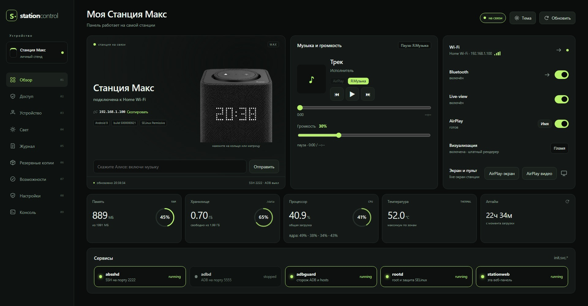
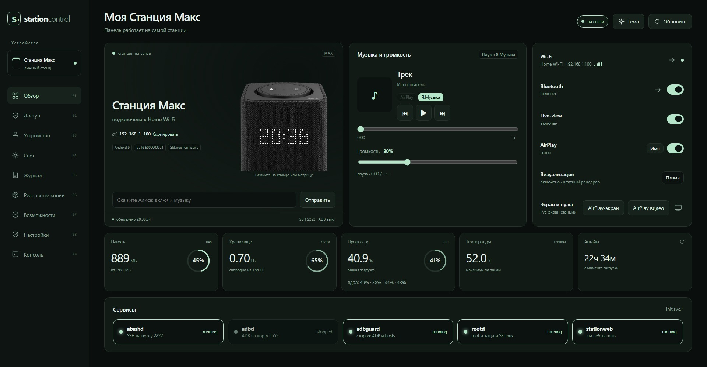
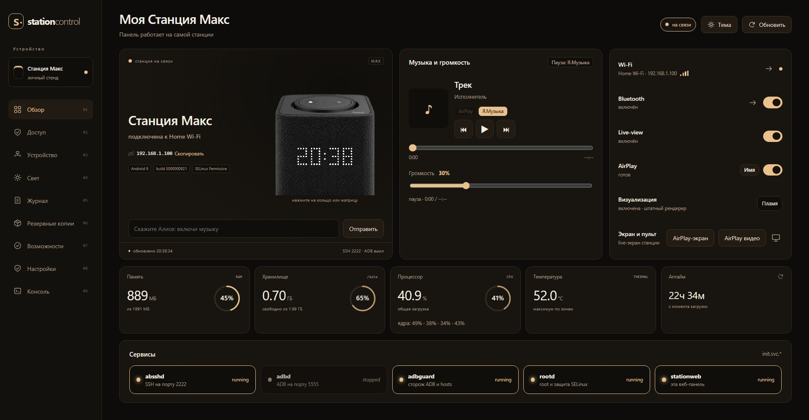
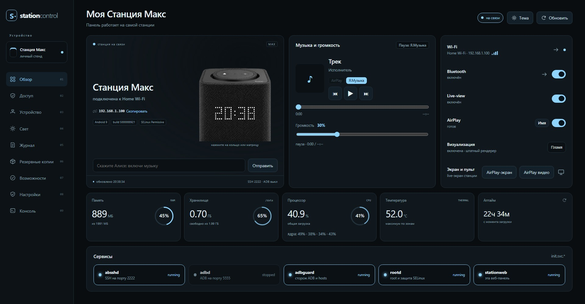
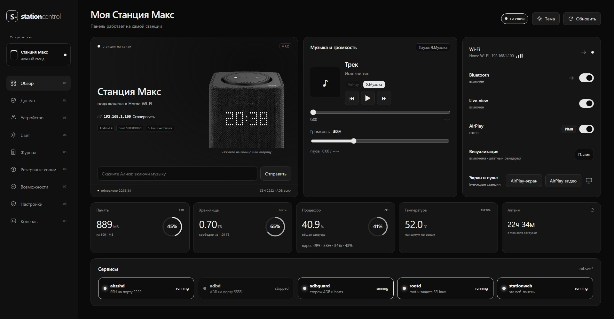

# Station Control — панель и AirPlay для Яндекс Станции Макс

**Station Control** — локальная панель управления станцией **Яндекс Станция
Макс** (Android 9, прошивка `PPR1.180610.011.5000000921`, YNDX-0008).
Работает на самой станции, без компьютера-посредника.

Проект вырос из **Station Control 0.4.4** — Windows-дашборда, который
запускался на компьютере и управлял станцией по ADB/SSH. Здесь та же идея
перенесена на саму станцию: панель, AirPlay-приёмники и обслуживание
работают локально на Android.

Что даёт:

- **Веб-панель** (`station-web`, Go): состояние станции, Wi-Fi, Bluetooth,
  громкость и пульт, кольцо и матрица, журнал, бэкапы, смена пароля.
  Тёмная тема с акцентом из `Settings.Global station_accent`.
- **AirPlay-аудио** — Shairport Sync на порту 7000, вкладка «AirPlay |
  Я.Музыка», выбор имени приёмника (имя из Умного дома + комната или своё).
- **AirPlay-видео** — отдельный приёмник на порту 7001 (форк
  `dypaul/android-airplay-server`): HLS, редиректы, cookies, тёмная тема.
  Защищённый DRM-контент не расшифровывается и честно объясняет это на экране.
- **ТВ-приложение** `com.opencode.airplaytv` — экран AirPlay на телевизоре.
- **Обслуживание**: watchdog `station-guard.sh`, аудит `station-audit.sh`,
  установка по SSH/ADB, откат на официальный APK приёмника.

## Происхождение

Оригинальный **Station Control 0.4.4** — Windows x64-пакет: установщик,
веб-панель на `127.0.0.1:8765`, подключение к станции по ADB/SSH и
управление матрицей, кольцом, музыкой и Wi-Fi с компьютера. В этом форке
панель и приёмники живут на самой станции, а ПК не нужен. Windows-пакет
в репозиторий не входит.

## Структура

```
station-web/           веб-панель (Go + встроенный фронтенд)
stage/airplay_video/   исходники видео-приёмника + скрипты сборки/установки
stage/tvapp/           ТВ-приложение
stage/app/             stationviz
stage/input, audio, bt, wifi, ops  исходники хелперов и обслуживания
stage/adbd_tcp.rc      init-сервисы: SSH, ADB, панель, watchdog
stage/adbguard.sh      сторож ADB
docs/OVERVIEW.md       подробное описание устройства и панели
docs/screenshots/      скриншоты панели для README
RELEASE.md             состав релиза, сборка, установка, откат, ограничения
```

`research/` и отладочные скрипты остаются локально и в публичный снимок не
входят.

## Готовые сборки

Готовые артефакты прикладываются к GitHub Release, а не коммитятся в репозиторий:

- `Station-Control-0.36.12-release.zip` — всё перечисленное ниже одним архивом;
- `station-web-0.36.12` — панель для `linux/arm64`;
- `airplay-video-0.0.38.apk` — видео-приёмник;
- `airplaytv-0.2.0.apk` — ТВ-приложение;
- `shairport-0.3.0.apk` — AirPlay-аудио;
- `wifi.dex` — root-хелпер Wi-Fi;
- `SHA256SUMS.txt` — контрольные суммы.

Скачайте нужные файлы и используйте `deploy.ps1`, `rollback.ps1` или
инструкции из [RELEASE.md](RELEASE.md). Лицензии сторонних APK — в
[YNDX-0008-guide/NOTICE.md](YNDX-0008-guide/NOTICE.md) и в `NOTICE.txt`
внутри архива релиза.

## Как выглядит панель

Скриншоты обезличены: Wi-Fi, IP и текущий трек заменены на примеры.

| Лайм | Мята |
|:---:|:---:|
|  |  |
| **Янтарь** | **Лёд** |
|  |  |
| **Ч/Б** | |
|  | |

## Быстрый старт

```powershell
.\deploy.ps1        # установить панель на станцию
.\rollback.ps1 -Target video   # вернуть официальный приёмник (APK из Release)
```

## Сборка из исходников

Этот путь нужен только разработчикам. `build-all.ps1` собирает панель,
видео APK и ТВ APK из исходников. Для панели достаточно Go; для видео и ТВ
нужен полный тулчейн: JDK 21, Android SDK/NDK, MinGW, MSYS Perl, а также
локальная раскладка `stage\bt` и `stage\airplay_apk` (точные пути — в
[RELEASE.md](RELEASE.md)). Без неё используйте готовые APK из Release.

## Лицензия

Наш код — **MIT** (см. [LICENSE](LICENSE)). AirPlay-видео
`stage/airplay_video/` — **GPLv3**, `lite-kit` — MIT, остальные сторонние
компоненты и их условия перечислены в [NOTICE.md](NOTICE.md).

## Ограничения

- FairPlay/DRM через AirPlay не воспроизводится: такие фильмы смотрите
  нативным приложением на станции.
- Bluetooth-наушники не поддерживаются: в прошивке только A2DP Sink.
- Всё рассчитано на доверенную домашнюю сеть; SSH и ADB включены как
  каналы обслуживания.

Подробности, проверки после OTA и точные версии — в [RELEASE.md](RELEASE.md).
